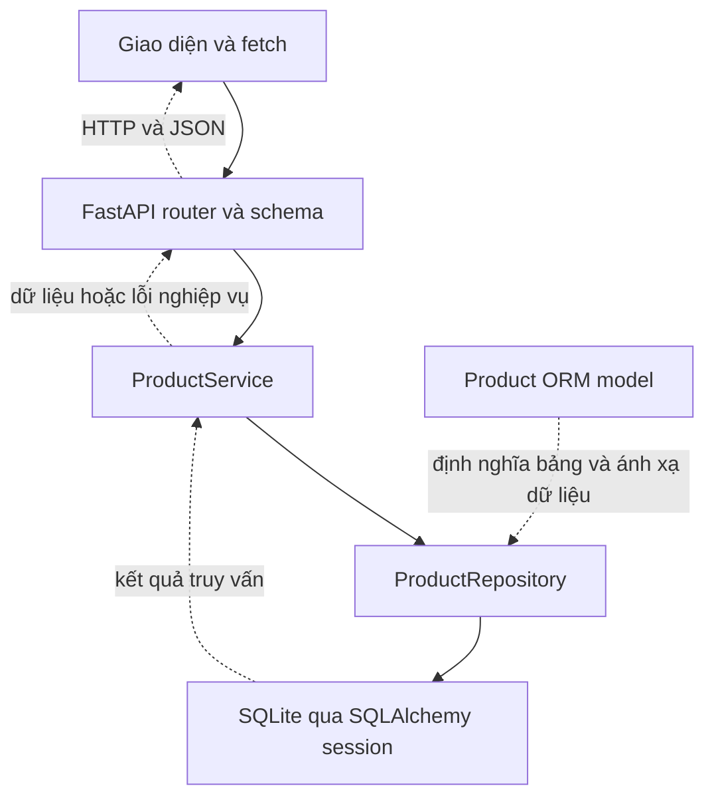

# Kiến trúc và luồng xử lý

Ứng dụng được chia theo trách nhiệm để một thay đổi không phải chạm mọi nơi. Router không viết truy vấn database; repository không quyết định giao diện hay HTTP status. Service điều phối nghiệp vụ và transaction. Schema vào/ra của API được tách khỏi model lưu trữ.

Model là định nghĩa cách ánh xạ dữ liệu, không phải một dịch vụ mà request phải gọi thêm sau repository. Mũi tên kết quả rút gọn đường trả về; thực tế kết quả đi qua repository và service trước khi router trả response.

## Theo dõi yêu cầu thêm sản phẩm

Khi bấm Lưu, `frontend/app.js` lấy giá trị form, đổi giá/tồn kho thành số và gọi `productApi.create(data)`. `api.js` gửi POST `/api/v1/products` với body JSON. Kiểm tra ở trình duyệt giúp phản hồi nhanh; backend vẫn kiểm tra độc lập vì người dùng có thể gọi API trực tiếp.

FastAPI tìm router và dùng `ProductCreate` trong `schemas/product.py` kiểm tra body. Tên trắng, giá âm, giá là chuỗi hoặc trường thừa bị từ chối với 422. Khi hợp lệ, route nhận một object đã kiểm tra và gọi service, không tự xây câu SQL.

Dependency trong `api/dependencies.py` mở một session cho request, ghép `ProductRepository(session)` và `ProductService(repository)`. Dependency injection ở đây nghĩa là nơi ghép các đối tượng được tập trung, thay vì mỗi route tự tạo kết nối.

Service yêu cầu repository thêm một `Product` vào session. Thao tác `session.add()` mới ghi nhận thay đổi đang chờ; service gọi `commit()` để lưu transaction. Nếu commit lỗi, service rollback và báo lỗi lên lớp HTTP. Sau commit, `refresh()` đọc lại bản ghi, gồm mã tự sinh.

Router trả object, response schema `ProductRead` lấy các trường hợp lệ rồi FastAPI chuyển thành JSON, status 201. Giao diện nhận thành công, tải danh sách mới và dựng hàng bằng `textContent`; tên/mô tả không được chèn như HTML.

## Luồng sửa và xóa

Khi bấm Sửa, giao diện gọi GET theo mã trước khi đưa dữ liệu lên form. PUT gửi bộ giá trị thay thế tới service. Service kiểm tra sản phẩm tồn tại, rồi nhờ repository cập nhật và commit. Không tìm thấy thì service báo `ProductNotFoundError`; handler đổi thành HTTP 404 với thông báo tiếng Việt.

Khi Xóa, repository đánh dấu bản ghi để xóa; service commit. Router trả 204, không có JSON body. `api.js` xử lý riêng 204 để không cố parse một body rỗng. Nếu xóa dòng cuối của trang cuối, giao diện tải lại trang hợp lệ gần nhất.

## Session và transaction khác nhau thế nào

Session là đối tượng làm việc với database trong một khoảng thời gian; transaction là nhóm thay đổi cùng được commit hoặc rollback. Mỗi request dùng một session riêng. Repository của project không tự commit, để service giữ quyền quyết định thời điểm lưu một use case. Session được đóng khi request kết thúc.

Các route và repository dùng API đồng bộ của SQLAlchemy. Route được khai báo bằng `def`, phù hợp với ví dụ I/O đồng bộ này; không chỉ đổi thành `async def` rồi gọi cùng truy vấn blocking. Khi học async sẽ thay toàn bộ cách truy cập dữ liệu tương ứng.

## Cách mở rộng mà vẫn giữ trách nhiệm

Nếu thêm `category`, cần thay ORM model, schema, form và việc hiển thị; đổi schema database bằng migration hoặc dùng database học mới. Không thể chỉ thêm trường Python rồi mong `create_all` tự sửa bảng đang tồn tại.

Nếu thêm quy tắc chỉ xóa sản phẩm hết hàng, đặt điều kiện trong service; HTTP handler chuyển lỗi nghiệp vụ tương ứng thành 409. Nếu thêm một bộ lọc tìm kiếm, router/schema kiểm tra tham số, service chuyển yêu cầu và repository xây truy vấn. Frontend chỉ hiển thị và gửi yêu cầu.

Nguồn tham khảo: [FastAPI về ứng dụng nhiều module](https://fastapi.tiangolo.com/tutorial/bigger-applications/), [SQLAlchemy về session và transaction](https://docs.sqlalchemy.org/en/20/orm/session_basics.html), [Pydantic Settings](https://docs.pydantic.dev/latest/concepts/pydantic_settings/). Việc chia service/repository trong repo là lựa chọn tổ chức để học trách nhiệm từng lớp, không phải yêu cầu bắt buộc của FastAPI.
