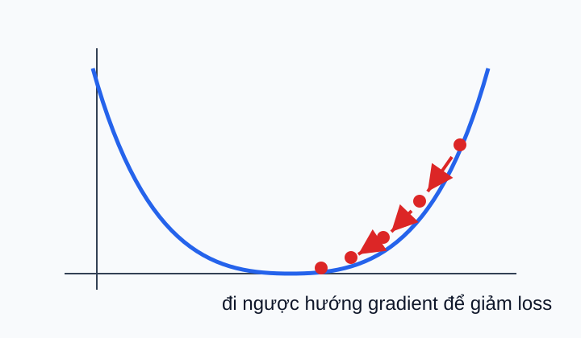
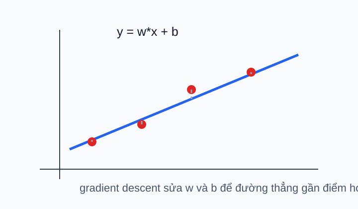

# Gradient and Optimization for AI Engineer

Gradient là cơ chế giúp model học. Model dự đoán sai, loss tăng; gradient cho biết phải
điều chỉnh tham số theo hướng nào để loss giảm. Nếu probability là ngôn ngữ của sự không
chắc chắn, gradient là động cơ của quá trình training.

## 1. Mục Tiêu Học

Sau chương này, bạn cần hiểu được:

- Đạo hàm đo độ dốc của hàm số tại một điểm.
- Gradient là vector đạo hàm riêng khi hàm có nhiều biến.
- Loss function đo model sai bao nhiêu.
- Gradient descent cập nhật tham số để giảm loss.
- Learning rate ảnh hưởng đến tốc độ và độ ổn định của training.
- PyTorch autograd tính gradient tự động như thế nào.

## 2. Bức Tranh Lớn

Một model machine learning thường có tham số.

Ví dụ linear regression:

```text
y_pred = w*x + b
```

Trong đó:

```text
w, b = tham số model cần học
```

Quy trình học:

```text
1. Dự đoán y_pred
2. So sánh với y thật để tính loss
3. Tính gradient của loss theo tham số
4. Cập nhật tham số theo hướng làm loss giảm
5. Lặp lại nhiều lần
```

Đây là training loop cốt lõi của rất nhiều model.

## 3. Đạo Hàm

Đạo hàm đo độ dốc của hàm số.

```text
f'(x) = mức thay đổi của f(x) / mức thay đổi của x
```

Ví dụ:

```text
f(x) = x^2
f'(x) = 2x
```

Tại các điểm:

```text
x = 3  -> f'(3) = 6   -> dốc lên
x = -2 -> f'(-2) = -4 -> dốc xuống
x = 0  -> f'(0) = 0   -> đáy của hàm
```

Tính gần đúng bằng Python:

```python
def derivative_at_point(f, x, h=0.0001):
    return (f(x + h) - f(x)) / h

f = lambda x: x**2

print(derivative_at_point(f, 3))   # gần 6
print(derivative_at_point(f, -2))  # gần -4
```

Trực giác:

- Đạo hàm dương: đi sang phải thì hàm tăng.
- Đạo hàm âm: đi sang phải thì hàm giảm.
- Đạo hàm bằng 0: có thể là điểm thấp, điểm cao hoặc điểm phẳng.

## 4. Partial Derivative

Khi hàm có nhiều biến, ta cần đạo hàm riêng.

Ví dụ:

```text
f(x, y) = x^2 + 2y^2
```

Đạo hàm riêng theo `x`:

```text
df/dx = 2x
```

Đạo hàm riêng theo `y`:

```text
df/dy = 4y
```

Ý nghĩa:

- `df/dx` cho biết nếu chỉ thay đổi `x`, hàm thay đổi thế nào.
- `df/dy` cho biết nếu chỉ thay đổi `y`, hàm thay đổi thế nào.

## 5. Gradient

Gradient là vector gồm các đạo hàm riêng.

```text
gradient = [df/dx, df/dy]
```

Với:

```text
f(x, y) = x^2 + 2y^2
```

Ta có:

```text
gradient = [2x, 4y]
```

Tại `x = 3`, `y = 2`:

```text
gradient = [6, 8]
```

Python với PyTorch:

```python
import torch

x = torch.tensor(3.0, requires_grad=True)
y = torch.tensor(2.0, requires_grad=True)

f = x**2 + 2*y**2
f.backward()

print(x.grad)  # tensor(6.)
print(y.grad)  # tensor(8.)
```

Trong AI, tham số model có thể là hàng triệu hoặc hàng tỷ số. Gradient cho biết mỗi tham số
nên được sửa theo hướng nào.

## 6. Loss Function

Loss function đo model sai bao nhiêu.

Ví dụ regression:

```text
MSE = mean((y_pred - y_true)^2)
```

Ví dụ classification:

```text
Cross-entropy loss
```

Model training thực chất là bài toán:

```text
Tìm tham số làm loss nhỏ nhất.
```

## 7. Gradient Descent

Gradient descent là thuật toán đi ngược hướng gradient để giảm loss.



Công thức:

```text
parameter_new = parameter_old - learning_rate * gradient
```

Vì gradient chỉ hướng làm hàm tăng nhanh nhất, muốn giảm loss thì ta đi ngược hướng gradient.

Ví dụ với:

```text
f(x) = x^2
gradient = 2x
```

Python:

```python
def gradient_descent_1d(start_x, learning_rate=0.1, steps=10):
    x = start_x

    for step in range(steps):
        gradient = 2 * x
        x = x - learning_rate * gradient
        print(f"step={step+1}, x={x:.4f}, f(x)={x**2:.4f}")

gradient_descent_1d(start_x=10)
```

Trực giác:

- Bắt đầu ở `x = 10`, loss là `100`.
- Mỗi bước kéo `x` gần 0 hơn.
- Vì đáy của `x^2` nằm tại `x = 0`, loss giảm dần.

## 8. Learning Rate

Learning rate quyết định mỗi bước cập nhật lớn hay nhỏ.

```text
learning_rate quá nhỏ -> học rất chậm
learning_rate vừa đủ -> loss giảm ổn định
learning_rate quá lớn -> loss dao động hoặc tăng vọt
```

Ví dụ:

```python
for lr in [0.01, 0.1, 1.1]:
    print("learning_rate =", lr)
    gradient_descent_1d(start_x=10, learning_rate=lr, steps=5)
```

Khi train neural network, chọn learning rate là một trong những quyết định quan trọng nhất.

## 9. Batch, Epoch, Iteration

Ba khái niệm hay gặp:

```text
Batch     = một nhóm sample đưa vào model trong một lần cập nhật
Iteration = một lần cập nhật tham số
Epoch     = một lượt model đi qua toàn bộ training data
```

Ví dụ:

```text
Dataset có 1.000 sample
Batch size = 100
1 epoch = 10 iterations
```

Vì sao dùng batch:

- Train nhanh hơn so với từng sample.
- Đỡ tốn memory hơn so với dùng toàn bộ dataset.
- Gradient có nhiễu vừa phải, đôi khi giúp optimization tốt hơn.

## 10. Ví Dụ: Linear Regression Tự Viết

Bài toán:

```text
Cho các điểm (1, 2), (2, 3), (3, 5)
Tìm đường thẳng y = w*x + b gần các điểm nhất.
```



Code:

```python
import numpy as np

X = np.array([1, 2, 3])
y = np.array([2, 3, 5])

w = 0.0
b = 0.0
lr = 0.01

def mse_loss(w, b):
    y_pred = w * X + b
    return np.mean((y_pred - y) ** 2)

for epoch in range(200):
    y_pred = w * X + b
    error = y_pred - y

    grad_w = 2 * np.mean(error * X)
    grad_b = 2 * np.mean(error)

    w = w - lr * grad_w
    b = b - lr * grad_b

    if epoch % 50 == 0:
        print(epoch, w, b, mse_loss(w, b))

print("final:", w, b)
```

Điều đang xảy ra:

- `w` điều khiển độ dốc đường thẳng.
- `b` điều khiển vị trí đường thẳng.
- Gradient cho biết nên sửa `w` và `b` bao nhiêu để MSE giảm.

## 11. Mô Phỏng Quá Trình Huấn Luyện Linear Regression

Phần này là bản mô phỏng chậm, để bạn nhìn thấy model học từng bước.

Bài toán:

```text
Input X:  [1, 2, 3]
Target y: [2, 3, 5]

Model: y_pred = w*x + b
Loss:  MSE = mean((y_pred - y)^2)
```

Lúc đầu model chưa biết gì, ta đặt:

```text
w = 0
b = 0
```

### Bước 1: Model dự đoán

Với `w = 0`, `b = 0`:

```text
y_pred = 0*x + 0

X = 1 -> y_pred = 0
X = 2 -> y_pred = 0
X = 3 -> y_pred = 0
```

So với target:

```text
y_true = [2, 3, 5]
y_pred = [0, 0, 0]
error  = [-2, -3, -5]
```

Loss:

```text
MSE = ((-2)^2 + (-3)^2 + (-5)^2) / 3
    = (4 + 9 + 25) / 3
    = 12.667
```

Loss đang cao, nghĩa là đường thẳng hiện tại dự đoán rất sai.

### Bước 2: Tính gradient

Với Linear Regression:

```text
y_pred = w*x + b
error = y_pred - y_true
```

Gradient của MSE:

```text
grad_w = 2 * mean(error * X)
grad_b = 2 * mean(error)
```

Tại epoch đầu:

```text
error = [-2, -3, -5]
X     = [1, 2, 3]

error * X = [-2, -6, -15]
mean(error * X) = -23/3 = -7.667

grad_w = 2 * -7.667 = -15.333
grad_b = 2 * mean([-2, -3, -5])
       = 2 * -3.333
       = -6.667
```

Gradient âm nghĩa là nếu tăng `w` và `b`, loss sẽ giảm.

### Bước 3: Cập nhật tham số

Công thức:

```text
w_new = w_old - learning_rate * grad_w
b_new = b_old - learning_rate * grad_b
```

Nếu `learning_rate = 0.1`:

```text
w_new = 0 - 0.1 * (-15.333) = 1.533
b_new = 0 - 0.1 * (-6.667)  = 0.667
```

Sau đúng 1 bước, model đổi từ:

```text
y_pred = 0*x + 0
```

thành:

```text
y_pred = 1.533*x + 0.667
```

Đường thẳng đã tiến gần dữ liệu hơn rất nhiều.

### Bước 4: Lặp lại nhiều epoch

Huấn luyện model là lặp lại vòng này:

```text
dự đoán -> tính loss -> tính gradient -> cập nhật w,b
```

Code mô phỏng rõ từng epoch:

```python
import numpy as np

X = np.array([1.0, 2.0, 3.0])
y = np.array([2.0, 3.0, 5.0])

w = 0.0
b = 0.0
learning_rate = 0.1
epochs = 20

def mse(y_pred, y_true):
    return np.mean((y_pred - y_true) ** 2)

print("epoch |    w    |    b    |  loss  | grad_w | grad_b")
print("-" * 58)

for epoch in range(epochs + 1):
    y_pred = w * X + b
    error = y_pred - y
    loss = mse(y_pred, y)

    grad_w = 2 * np.mean(error * X)
    grad_b = 2 * np.mean(error)

    print(
        f"{epoch:5d} | {w:7.3f} | {b:7.3f} | "
        f"{loss:6.3f} | {grad_w:6.3f} | {grad_b:6.3f}"
    )

    w = w - learning_rate * grad_w
    b = b - learning_rate * grad_b
```

Bạn nên quan sát:

- `loss` giảm dần qua các epoch.
- `w` tiến gần khoảng `1.5`.
- `b` tiến gần khoảng `0.33`.
- Đường thẳng tốt nhất xấp xỉ `y = 1.5x + 0.33`.

### Vì sao không ra đúng tuyệt đối mọi điểm?

Ba điểm:

```text
(1, 2), (2, 3), (3, 5)
```

không nằm hoàn toàn trên một đường thẳng hoàn hảo. Vì vậy Linear Regression tìm đường thẳng
giảm tổng lỗi tốt nhất, chứ không nhất thiết đi qua mọi điểm.

Nếu dữ liệu là:

```text
(1, 2), (2, 4), (3, 6)
```

thì đường thẳng `y = 2x` có thể khớp hoàn hảo.

### Ý nghĩa AI

Ví dụ nhỏ này chính là phiên bản đơn giản của training model:

```text
w, b nhỏ          -> vài tham số
neural network    -> hàng triệu hoặc hàng tỷ tham số
MSE loss          -> loss function
gradient descent  -> optimizer cập nhật tham số
epoch             -> một vòng học qua dữ liệu
```

Điểm khác là neural network có nhiều layer hơn, tham số nhiều hơn và loss phức tạp hơn,
nhưng nhịp học cốt lõi vẫn là:

```text
forward -> loss -> backward -> update
```

## 12. Ví Dụ Toán Học Và Thực Tiễn

### Ví dụ 1: Tối ưu hàm đơn giản `f(x) = (x - 3)^2`

Ví dụ toán học:

```text
f(x) = (x - 3)^2
```

Hàm đạt giá trị nhỏ nhất tại:

```text
x = 3
```

Đạo hàm:

```text
f'(x) = 2(x - 3)
```

Nếu bắt đầu tại `x = 0`:

```text
f'(0) = 2(0 - 3) = -6
```

Cập nhật với learning rate `0.1`:

```text
x_new = x_old - lr * gradient
      = 0 - 0.1 * (-6)
      = 0.6
```

Ví dụ thực tiễn:

```text
Gradient descent kéo x từ 0 tiến dần về 3.
Đây là bản thu nhỏ của việc kéo tham số model về giá trị làm loss thấp hơn.
```

Ý nghĩa AI:

- Model không biết tham số tốt ngay từ đầu.
- Gradient giúp tham số đi từng bước về vùng tốt hơn.

### Ví dụ 2: Dự đoán giá nhà bằng Linear Regression

Ví dụ toán học:

```text
y_pred = w*area + b
```

Giả sử:

```text
area = 100 m2
w = 3
b = 200
```

Dự đoán:

```text
y_pred = 3*100 + 200 = 500 triệu
```

Nếu giá thật là `550 triệu`:

```text
error = 500 - 550 = -50
loss = (-50)^2 = 2500
```

Ví dụ thực tiễn:

```text
Model đang dự đoán thấp hơn thực tế.
Gradient sẽ điều chỉnh w hoặc b để lần sau dự đoán cao hơn.
```

Ý nghĩa AI:

- `w` học mức giá tăng theo diện tích.
- `b` học giá nền khi feature bằng 0 hoặc đóng vai trò offset.

### Ví dụ 3: Learning rate quá nhỏ và quá lớn

Ví dụ toán học:

```text
parameter = 10
gradient = 20
```

Nếu `learning_rate = 0.001`:

```text
new_parameter = 10 - 0.001*20 = 9.98
```

Bước đi rất nhỏ, học chậm.

Nếu `learning_rate = 1.0`:

```text
new_parameter = 10 - 1.0*20 = -10
```

Bước đi quá mạnh, có thể vượt qua điểm tốt.

Ví dụ thực tiễn:

```text
Khi train model, learning rate quá nhỏ làm training mất nhiều thời gian.
Learning rate quá lớn làm loss nhảy lung tung hoặc tăng vọt.
```

Ý nghĩa AI:

- Theo dõi loss curve giúp phát hiện learning rate có hợp lý không.
- Nếu loss không giảm, một trong những thứ đầu tiên cần kiểm tra là learning rate.

### Ví dụ 4: Cross-entropy trong bài toán phân loại

Ví dụ toán học:

Nhãn thật là `cat`.

```text
Model A: P(cat) = 0.9
Model B: P(cat) = 0.2
```

Cross-entropy cho class đúng:

```text
loss = -log(P(class đúng))
```

Tính:

```text
loss_A = -log(0.9) ≈ 0.105
loss_B = -log(0.2) ≈ 1.609
```

Ví dụ thực tiễn:

```text
Model A tự tin vào đáp án đúng nên loss thấp.
Model B cho xác suất thấp cho đáp án đúng nên loss cao.
```

Ý nghĩa AI:

- Gradient của cross-entropy sẽ đẩy model tăng xác suất cho class đúng.
- Đây là cách classification model học từ nhãn.

### Ví dụ 5: Một training loop thực tế nhìn như thế nào

Ví dụ toán học:

```text
forward:
    y_pred = model(X)

loss:
    loss = compare(y_pred, y_true)

backward:
    gradient = d(loss)/d(parameter)

update:
    parameter = parameter - lr * gradient
```

Ví dụ thực tiễn:

```text
Train model nhận diện spam:
1. Đưa email vào model.
2. Model dự đoán xác suất spam.
3. So sánh với nhãn thật.
4. Tính gradient.
5. Cập nhật weights.
6. Lặp lại với nhiều batch email.
```

Ý nghĩa AI:

- Dù là linear regression, spam classifier hay neural network lớn, nhịp train vẫn giống nhau.
- Khác biệt nằm ở model phức tạp hơn, dữ liệu lớn hơn và optimizer thông minh hơn.

## 13. PyTorch Autograd

PyTorch tự động xây graph tính toán và tính gradient bằng `backward()`.

```python
import torch

x = torch.tensor(3.0, requires_grad=True)
y = x**2

y.backward()

print(x.grad)  # 6
```

Điều kiện để PyTorch tính gradient:

- Tensor phải có `requires_grad=True`.
- Kết quả phải phụ thuộc vào tensor đó.
- Gọi `.backward()` trên output scalar hoặc truyền gradient phù hợp.

## 14. PyTorch Training Loop

Ví dụ dự đoán giá nhà từ diện tích:

```python
import torch
import torch.nn as nn

areas = torch.tensor([[50.0], [100.0], [150.0], [200.0]])
prices = torch.tensor([[300.0], [500.0], [700.0], [900.0]])

model = nn.Linear(1, 1)
criterion = nn.MSELoss()
optimizer = torch.optim.SGD(model.parameters(), lr=0.0001)

for epoch in range(500):
    predictions = model(areas)
    loss = criterion(predictions, prices)

    optimizer.zero_grad()
    loss.backward()
    optimizer.step()

new_area = torch.tensor([[120.0]])
print(model(new_area))
```

Ba dòng quan trọng nhất:

```python
optimizer.zero_grad()  # xóa gradient cũ
loss.backward()        # tính gradient mới
optimizer.step()       # cập nhật tham số
```

Nếu quên `zero_grad()`, gradient sẽ bị cộng dồn qua nhiều bước và training có thể sai.

## 15. SGD, Mini-batch SGD Và Adam

Các optimizer thường gặp:

```text
Gradient Descent      -> dùng toàn bộ dataset để cập nhật
Stochastic GD         -> dùng 1 sample mỗi lần cập nhật
Mini-batch SGD        -> dùng một batch nhỏ
Adam                  -> optimizer phổ biến, tự điều chỉnh tốc độ theo từng tham số
```

Trong deep learning, Adam thường là lựa chọn mặc định tốt để bắt đầu.

## 16. Ứng Dụng Trong AI

Gradient xuất hiện trong:

- Linear regression.
- Logistic regression.
- Neural network.
- Backpropagation.
- Fine-tuning model.
- Training embedding.
- Reinforcement learning.

Hầu hết deep learning hiện đại đều dựa trên ý tưởng:

```text
Tính loss -> tính gradient -> cập nhật tham số.
```

## 17. Lỗi Hay Nhầm

- Nghĩ gradient là loss. Loss là mức sai; gradient là hướng sửa.
- Learning rate quá lớn làm loss tăng thay vì giảm.
- Quên `optimizer.zero_grad()` trong PyTorch.
- Gọi `.backward()` nhiều lần trên cùng graph mà không hiểu graph đã bị giải phóng.
- Dùng feature chưa scale làm gradient descent khó hội tụ.
- Nghĩ gradient descent luôn tìm được global minimum; với neural network, loss landscape phức tạp hơn.
- Nhìn code training mà không tách được 4 bước: forward, loss, backward, update.

## 18. Bài Tập

### Cơ bản

1. Với `f(x)=x^2`, tính đạo hàm tại `x=5`.
2. Với `f(x)=3x^2`, tính đạo hàm tại `x=2`.
3. Với `f(x,y)=x^2+y^2`, tính gradient tại `(3,4)`.

### Trung bình

1. Viết gradient descent để tìm min của `f(x)=(x-3)^2`.
2. Thử learning rate `0.01`, `0.1`, `1.0` và so sánh.
3. Tự viết linear regression bằng NumPy cho 5 điểm dữ liệu.
4. In bảng `epoch, w, b, loss, grad_w, grad_b` rồi giải thích vì sao loss giảm.

### AI-oriented

1. Giải thích training loop PyTorch bằng lời của bạn.
2. Giải thích vì sao cần `loss.backward()` trước `optimizer.step()`.
3. Giải thích vì sao feature scaling có thể giúp gradient descent ổn định hơn.
4. So sánh training loop NumPy tự viết với training loop PyTorch.

## 19. Checklist Cần Nhớ

- Đạo hàm đo độ dốc tại một điểm.
- Gradient là vector đạo hàm riêng.
- Loss đo model sai bao nhiêu.
- Gradient cho biết hướng sửa tham số.
- Gradient descent đi ngược hướng gradient để giảm loss.
- Learning rate quá nhỏ học chậm, quá lớn dễ mất ổn định.
- PyTorch dùng autograd để tính gradient tự động.
