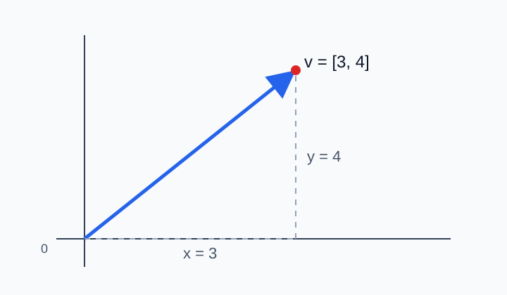
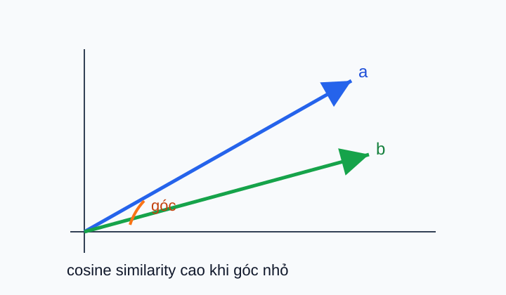

# Linear Algebra for AI Engineer

Linear algebra là ngôn ngữ của dữ liệu dạng số. Nếu muốn hiểu embedding, neural network,
attention, recommendation system hoặc vector database, đây là phần nền móng.



## 1. Mục Tiêu Học

Sau chương này, bạn cần hiểu được:

- Vector là gì và vì sao dữ liệu AI thường được biểu diễn bằng vector.
- Dot product đo mức độ cùng hướng như thế nào.
- Norm là độ dài toán học của vector.
- Cosine similarity dùng để so sánh embedding ra sao.
- Matrix multiplication liên quan đến layer trong neural network như thế nào.

## 2. Bức Tranh Lớn

Trong lập trình thông thường, dữ liệu có thể là string, object, JSON hoặc record trong database.
Trong AI, để model xử lý được dữ liệu, ta thường chuyển dữ liệu thành số.

Ví dụ:

```text
"Tôi muốn học AI"      -> [0.82, 0.13, 0.44, ...]
"Cách học machine learning" -> [0.79, 0.18, 0.47, ...]
```

Mảng số này gọi là vector hoặc embedding. Nếu hai câu gần nghĩa nhau, vector của chúng thường
gần nhau trong không gian vector.

## 3. Vector

Vector là một danh sách số có thứ tự.

```text
v = [3, 4]
w = [1, 2, 3]
```

Có 2 cách nhìn:

- Hình học: vector là một mũi tên trong không gian.
- AI: vector là bộ đặc trưng số đại diện cho dữ liệu.

Ví dụ hình học:

```text
v = [3, 4]
```

Nghĩa là đi 3 đơn vị theo trục x và 4 đơn vị theo trục y.

Python:

```python
import numpy as np

v = np.array([3, 4])
print(v)
```

Trong AI:

- Một từ có thể là vector.
- Một câu có thể là vector.
- Một ảnh có thể là vector hoặc tensor.
- Một user trong recommendation system có thể là vector sở thích.

## 4. Dot Product

Dot product, hay tích vô hướng, nhân từng cặp phần tử rồi cộng lại.

```text
a . b = a1*b1 + a2*b2 + ... + an*bn
```

Ví dụ tính tay:

```text
a = [1, 2]
b = [3, 4]

a . b = 1*3 + 2*4 = 3 + 8 = 11
```

Python:

```python
import numpy as np

a = np.array([1, 2])
b = np.array([3, 4])

print(np.dot(a, b))  # 11
```

Trực giác:

- Dot product lớn dương: hai vector khá cùng hướng.
- Dot product bằng 0: hai vector vuông góc.
- Dot product âm: hai vector ngược hướng.

Trong AI, dot product xuất hiện rất nhiều:

- Tính điểm similarity giữa query và document.
- Tính attention score.
- Tính output của linear layer.

## 5. Norm

Norm là độ dài của vector.

Với L2 norm:

```text
||v|| = sqrt(v1^2 + v2^2 + ... + vn^2)
```

Ví dụ tính tay:

```text
v = [3, 4]
||v|| = sqrt(3^2 + 4^2)
     = sqrt(9 + 16)
     = 5
```

Python:

```python
import numpy as np

v = np.array([3, 4])
print(np.linalg.norm(v))  # 5.0
```

Lỗi hay nhầm:

```python
len([3, 4])  # 2
```

`len(vector)` chỉ là số phần tử, không phải độ dài toán học.

## 6. Cosine Similarity

Cosine similarity đo độ giống nhau về hướng giữa hai vector.



Công thức:

```text
cos_sim(a, b) = (a . b) / (||a|| * ||b||)
```

Kết quả:

```text
 1  -> cùng hướng, rất giống
 0  -> vuông góc, ít liên quan
-1  -> ngược hướng
```

Ví dụ tính tay:

```text
a = [1, 2]
b = [2, 4]

a . b = 1*2 + 2*4 = 10
||a|| = sqrt(1^2 + 2^2) = sqrt(5)
||b|| = sqrt(2^2 + 4^2) = sqrt(20)

cos_sim = 10 / (sqrt(5) * sqrt(20)) = 1
```

Vì `b` chỉ là `a` phóng to lên 2 lần, hướng không đổi, nên cosine similarity bằng 1.

Python:

```python
import numpy as np

def cosine_similarity(a, b):
    dot = np.dot(a, b)
    norm_a = np.linalg.norm(a)
    norm_b = np.linalg.norm(b)
    return dot / (norm_a * norm_b)

a = np.array([1, 2])
b = np.array([2, 4])

print(cosine_similarity(a, b))  # 1.0
```

## 7. Matrix

Matrix là bảng số 2 chiều.

```text
A = [
  [1, 2, 3],
  [4, 5, 6]
]
```

Shape của `A` là:

```text
2 rows x 3 columns
```

Python:

```python
import numpy as np

A = np.array([
    [1, 2, 3],
    [4, 5, 6],
])

print(A.shape)  # (2, 3)
```

Trong AI:

- Dataset thường là matrix: `n_samples x n_features`.
- Weight của linear layer là matrix.
- Batch embedding cũng là matrix.

## 8. Matrix Multiplication

Matrix multiplication là phép nhân nền tảng trong neural network.

Điều kiện nhân:

```text
A shape = (m, n)
B shape = (n, p)
A @ B shape = (m, p)
```

Ví dụ:

```python
import numpy as np

X = np.array([
    [1, 2],
    [3, 4],
    [5, 6],
])  # shape (3, 2)

W = np.array([
    [0.1, 0.2, 0.3],
    [0.4, 0.5, 0.6],
])  # shape (2, 3)

Y = X @ W
print(Y.shape)  # (3, 3)
```

Liên hệ neural network:

```text
output = input @ weights + bias
```

Đây chính là trái tim của một linear layer.

## 9. Python Lab: Semantic Search Nhỏ

Giả sử ta có 3 câu đã được chuyển thành vector:

```python
import numpy as np

questions = {
    "How to learn AI?": np.array([0.8, 0.3, 0.5]),
    "What is machine learning?": np.array([0.2, 0.7, 0.1]),
    "Cách học AI như thế nào?": np.array([0.75, 0.35, 0.55]),
}

query = questions["How to learn AI?"]

def cosine_similarity(a, b):
    return np.dot(a, b) / (np.linalg.norm(a) * np.linalg.norm(b))

for text, vector in questions.items():
    score = cosine_similarity(query, vector)
    print(text, round(score, 3))
```

Ý nghĩa:

- Câu có score gần 1 nhất là câu gần nghĩa nhất.
- Trong thực tế, embedding không tự viết tay mà được tạo bởi model như OpenAI embeddings, BERT hoặc Sentence Transformers.

## 10. Ví Dụ Toán Học Và Thực Tiễn

### Ví dụ 1: Vector biểu diễn vị trí trên bản đồ

Ví dụ toán học:

```text
Nhà A = [2, 3]
Nhà B = [5, 7]
```

Vector từ A đến B:

```text
B - A = [5 - 2, 7 - 3] = [3, 4]
```

Khoảng cách:

```text
||B - A|| = sqrt(3^2 + 4^2) = 5
```

Ví dụ thực tiễn:

```text
App giao hàng cần tính khoảng cách giữa shipper và khách hàng.
Nếu biểu diễn vị trí bằng vector tọa độ, khoảng cách có thể tính bằng norm.
```

Ý nghĩa AI:

- Hệ thống recommendation theo vị trí có thể ưu tiên quán gần user.
- Clustering có thể nhóm các điểm gần nhau trên bản đồ.

### Ví dụ 2: Dot product để tính điểm phù hợp user và sản phẩm

Ví dụ toán học:

```text
user = [0.9, 0.1, 0.8]
item = [0.8, 0.2, 0.7]

dot = 0.9*0.8 + 0.1*0.2 + 0.8*0.7
    = 0.72 + 0.02 + 0.56
    = 1.30
```

Giả sử 3 chiều lần lượt là:

```text
[thích công nghệ, thích thời trang, thích AI]
```

Ví dụ thực tiễn:

```text
User thích công nghệ và AI.
Item cũng là sản phẩm công nghệ/AI.
Dot product cao -> hệ thống nên recommend item này.
```

Ý nghĩa AI:

- Recommendation system thường dùng vector user và vector item.
- Dot product là một cách đơn giản để tính mức độ phù hợp.

### Ví dụ 3: Cosine similarity để tìm câu giống nhau

Ví dụ toán học:

```text
câu A = [1, 1, 1, 0]
câu B = [1, 1, 0, 1]

dot = 1*1 + 1*1 + 1*0 + 0*1 = 2
||A|| = sqrt(1^2 + 1^2 + 1^2 + 0^2) = sqrt(3)
||B|| = sqrt(1^2 + 1^2 + 0^2 + 1^2) = sqrt(3)

cos_sim = 2 / (sqrt(3) * sqrt(3)) = 2/3 = 0.667
```

Ví dụ thực tiễn:

```text
User hỏi: "Cách học AI?"
Database có câu: "Lộ trình học machine learning"
Nếu embedding của hai câu có cosine similarity cao, chatbot có thể lấy tài liệu đó để trả lời.
```

Ý nghĩa AI:

- Đây là nền tảng của semantic search.
- RAG system thường tìm tài liệu liên quan bằng similarity giữa embedding.

### Ví dụ 4: Matrix biểu diễn nhiều sample cùng lúc

Ví dụ toán học:

```text
X = [
  [50, 2],
  [80, 3],
  [120, 4]
]
```

Mỗi hàng là một căn nhà:

```text
[diện tích, số phòng ngủ]
```

Weight:

```text
w = [3, 20]
```

Dự đoán giá thô:

```text
X @ w = [
  50*3 + 2*20,
  80*3 + 3*20,
  120*3 + 4*20
]
= [190, 300, 440]
```

Ví dụ thực tiễn:

```text
Model dự đoán giá nhà dùng nhiều feature cùng lúc.
Matrix giúp tính dự đoán cho cả batch dữ liệu trong một phép nhân.
```

Ý nghĩa AI:

- Neural network xử lý dữ liệu theo batch để nhanh hơn.
- Matrix multiplication giúp tận dụng GPU.

### Ví dụ 5: Linear layer trong neural network

Ví dụ toán học:

```text
input = [0.5, 1.0]
weights = [
  [0.2, 0.8],
  [0.4, 0.1]
]
bias = [0.1, 0.2]
```

Tính:

```text
output = input @ weights + bias

output_1 = 0.5*0.2 + 1.0*0.4 + 0.1 = 0.6
output_2 = 0.5*0.8 + 1.0*0.1 + 0.2 = 0.7
```

Ví dụ thực tiễn:

```text
Một layer trong neural network nhận vector đầu vào,
nhân với weights, cộng bias, rồi truyền qua activation.
```

Ý nghĩa AI:

- Linear algebra không phải lý thuyết xa vời.
- Mỗi lần model chạy forward, rất nhiều phép nhân matrix đang diễn ra.

## 11. Ứng Dụng Trong AI

Linear algebra xuất hiện trong:

- Embedding search: tìm vector gần nhất.
- Recommendation system: so sánh user vector và item vector.
- Neural network: nhân matrix qua nhiều layer.
- Attention: dot product giữa query và key.
- Computer vision: ảnh là tensor gồm height, width, channel.

## 12. Lỗi Hay Nhầm

- Nhầm `len(vector)` với norm.
- Nghĩ dot product luôn là similarity tốt, trong khi nó bị ảnh hưởng bởi độ lớn vector.
- Quên kiểm tra shape khi nhân matrix.
- Dùng cosine similarity với vector toàn 0, gây chia cho 0.
- Nghĩ embedding dễ hiểu từng chiều, trong khi nhiều embedding là representation học được, khó diễn giải từng chiều riêng lẻ.

## 13. Bài Tập

### Cơ bản

1. Tính dot product của `a = [2, 3]` và `b = [4, 5]`.
2. Tính norm của `v = [6, 8]`.
3. Tính cosine similarity của `a = [1, 0]` và `b = [0, 1]`.

### Trung bình

1. Viết hàm Python tự tính dot product không dùng `np.dot`.
2. Viết hàm Python tự tính cosine similarity.
3. Tạo 5 vector câu giả định và tìm câu gần nhất với query.

### AI-oriented

1. Giải thích vì sao cosine similarity hay dùng trong semantic search.
2. Giải thích vì sao linear layer có dạng `output = input @ weights + bias`.
3. Tìm hiểu attention score trong transformer dùng dot product như thế nào.

## 14. Checklist Cần Nhớ

- Vector là mảng số biểu diễn dữ liệu.
- Matrix là bảng số 2 chiều.
- Dot product đo mức độ cùng hướng theo cách thô.
- Norm là độ dài toán học.
- Cosine similarity đo độ giống nhau về hướng.
- Matrix multiplication là nền tảng của neural network.
