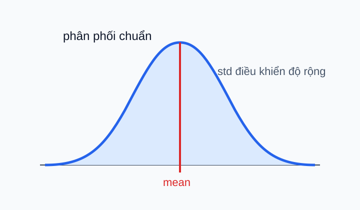
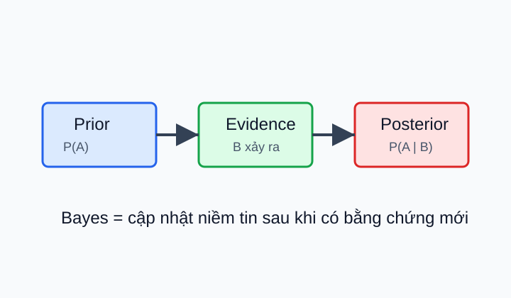

# Probability for AI Engineer

Probability là ngôn ngữ của sự không chắc chắn. Trong AI, model hiếm khi biết chắc tuyệt đối.
Nó thường đưa ra xác suất: email này có 92% khả năng là spam, ảnh này 87% là mèo, token tiếp
theo có xác suất cao nhất là từ nào.

## 1. Mục Tiêu Học

Sau chương này, bạn cần hiểu được:

- Sample space, event và probability là gì.
- Khi nào dùng quy tắc cộng, khi nào dùng quy tắc nhân.
- Random variable và distribution mô tả dữ liệu bất định như thế nào.
- Expected value và variance của phân phối có ý nghĩa gì.
- Conditional probability và Bayes khác nhau ra sao.
- Likelihood, entropy và cross-entropy liên quan thế nào đến machine learning.

## 2. Bức Tranh Lớn

Machine learning không chỉ là tìm câu trả lời, mà là học pattern từ dữ liệu không hoàn hảo.
Probability giúp model biểu diễn mức độ tin tưởng.

Ví dụ:

```text
Spam classifier:
P(spam | email) = 0.92

Image classifier:
P(cat | image) = 0.87

Language model:
P("học" | "tôi muốn") = 0.31
P("ăn" | "tôi muốn") = 0.12
```

## 3. Sample Space Và Event

Sample space là tập tất cả kết quả có thể xảy ra.

Ví dụ tung xúc sắc:

```text
S = {1, 2, 3, 4, 5, 6}
```

Event là một tập con của sample space.

Ví dụ:

```text
A = ra số chẵn = {2, 4, 6}
B = ra số lớn hơn 4 = {5, 6}
```

Xác suất:

```text
P(A) = số kết quả thuận lợi / tổng số kết quả
P(A) = 3 / 6 = 0.5
```

## 4. Quy Tắc Xác Suất Cơ Bản

### Complement

```text
P(not A) = 1 - P(A)
```

Ví dụ:

```text
P(ra số 6) = 1/6
P(không ra số 6) = 1 - 1/6 = 5/6
```

### Union

Union là A hoặc B xảy ra.

```text
P(A or B) = P(A) + P(B) - P(A and B)
```

Ta trừ `P(A and B)` vì phần giao bị cộng hai lần.

### Intersection

Intersection là A và B cùng xảy ra.

Nếu A và B độc lập:

```text
P(A and B) = P(A) * P(B)
```

Ví dụ tung đồng xu 2 lần:

```text
P(lần 1 ngửa và lần 2 sấp) = 1/2 * 1/2 = 1/4
```

## 5. Independent Và Mutually Exclusive

Hai khái niệm này rất dễ nhầm.

Independent nghĩa là A xảy ra không làm thay đổi xác suất của B.

```text
Tung đồng xu lần 1 và lần 2 là độc lập.
```

Mutually exclusive nghĩa là A và B không thể cùng xảy ra.

```text
Một lần tung xúc sắc không thể vừa ra 2 vừa ra 5.
```

Lưu ý:

```text
Mutually exclusive thường không phải independent.
```

Nếu đã biết xúc sắc ra 2, xác suất ra 5 trong cùng lần tung là 0.

## 6. Random Variable

Random variable là biến nhận giá trị phụ thuộc vào kết quả ngẫu nhiên.

Ví dụ:

```text
X = kết quả tung xúc sắc
X có thể là 1, 2, 3, 4, 5, 6
```

Có 2 loại chính:

- Discrete random variable: nhận các giá trị rời rạc.
- Continuous random variable: nhận giá trị liên tục.

Ví dụ trong AI:

```text
X = số email spam trong ngày
Y = xác suất user click quảng cáo
Z = confidence score của model
```

## 7. Distribution

Distribution mô tả xác suất nằm trên các giá trị như thế nào.

### Discrete Distribution

Ví dụ xúc sắc công bằng:

```text
P(X=1) = 1/6
P(X=2) = 1/6
...
P(X=6) = 1/6
```

### Continuous Distribution

Với biến liên tục như chiều cao, xác suất tại đúng một điểm thường bằng 0.

Ta quan tâm xác suất trong khoảng:

```text
P(1.70 <= height <= 1.80)
```

## 8. Các Phân Phối Nên Biết

### Bernoulli

Một thử nghiệm chỉ có 2 kết quả: 0 hoặc 1.

Ví dụ:

```text
Email là spam hay không spam.
User click hay không click.
```

### Binomial

Đếm số lần thành công trong nhiều thử nghiệm Bernoulli.

Ví dụ:

```text
Trong 100 email, có bao nhiêu email là spam?
```

### Categorical

Một kết quả thuộc nhiều class.

Ví dụ:

```text
Ảnh thuộc class: cat, dog, car, tree.
```

### Normal/Gaussian

Phân phối hình chuông.



Dùng nhiều trong:

- Lỗi đo lường.
- Dữ liệu tự nhiên như chiều cao.
- Khởi tạo và phân tích thống kê.

Python:

```python
import numpy as np

samples = np.random.normal(loc=0, scale=1, size=1000)
print(np.mean(samples))
print(np.std(samples))
```

## 9. Expected Value Và Variance

Expected value là giá trị trung bình kỳ vọng nếu lặp lại thử nghiệm rất nhiều lần.

Với biến rời rạc:

```text
E[X] = sum(x * P(X=x))
```

Ví dụ xúc sắc công bằng:

```text
E[X] = 1*(1/6) + 2*(1/6) + ... + 6*(1/6)
     = 3.5
```

Variance của phân phối đo mức độ biến ngẫu nhiên dao động quanh expected value.

Trong AI:

- Loss thường là kỳ vọng lỗi trên dữ liệu.
- Model evaluation là ước lượng hiệu năng kỳ vọng trên dữ liệu thật.

## 10. Conditional Probability

Conditional probability là xác suất của A khi đã biết B xảy ra.

```text
P(A | B) = P(A and B) / P(B)
```

Đọc là: xác suất A, biết rằng B đã xảy ra.

Ví dụ khảo sát:

```text
100 người
40 người thích coffee
30 người thích tea
20 người thích cả coffee và tea
```

Tính:

```text
P(tea | coffee) = 20 / 40 = 0.5
P(coffee | tea) = 20 / 30 = 0.667
```

Lưu ý:

```text
P(A | B) thường khác P(B | A)
```

## 11. Bayes Theorem

Bayes giúp cập nhật niềm tin khi có bằng chứng mới.



Công thức:

```text
P(A | B) = P(B | A) * P(A) / P(B)
```

Tên gọi từng phần:

```text
P(A)       = prior
P(B | A)   = likelihood
P(B)       = evidence
P(A | B)   = posterior
```

Ví dụ chẩn đoán bệnh:

```text
P(bệnh) = 1%
P(dương tính | bệnh) = 99%
P(dương tính | không bệnh) = 5%
```

Python:

```python
p_benh = 0.01
p_khong_benh = 0.99

p_pos_given_benh = 0.99
p_pos_given_khong_benh = 0.05

p_pos = p_pos_given_benh * p_benh + p_pos_given_khong_benh * p_khong_benh
p_benh_given_pos = p_pos_given_benh * p_benh / p_pos

print(p_benh_given_pos)  # khoảng 0.167
```

Kết quả khoảng 16.7%. Dù test khá chính xác, bệnh quá hiếm nên dương tính giả vẫn nhiều.

## 12. Likelihood

Probability thường hỏi:

```text
Biết model/tham số rồi, xác suất dữ liệu là bao nhiêu?
```

Likelihood thường hỏi ngược lại:

```text
Biết dữ liệu rồi, tham số nào làm dữ liệu này có khả năng xuất hiện cao nhất?
```

Ví dụ tung đồng xu 10 lần, thấy 7 lần ngửa.

Ta muốn ước lượng `p`, xác suất ra ngửa. Trực giác: `p` hợp lý sẽ gần `0.7`.

Trong machine learning:

```text
Training thường có thể hiểu là tìm tham số làm dữ liệu quan sát được có likelihood cao.
```

## 13. Entropy

Entropy đo độ bất định của một phân phối.

Ví dụ:

```text
Đồng xu công bằng: P(ngửa)=0.5, P(sấp)=0.5 -> bất định cao
Đồng xu lệch: P(ngửa)=0.99, P(sấp)=0.01 -> bất định thấp
```

Trong AI:

- Output phân phối đều giữa nhiều class: model chưa chắc chắn.
- Output tập trung vào một class: model tự tin hơn.

## 14. Cross-Entropy

Cross-entropy đo phân phối dự đoán của model lệch khỏi nhãn thật bao nhiêu.

Ví dụ classification:

```text
Nhãn thật: cat

Model A: P(cat)=0.9 -> loss thấp
Model B: P(cat)=0.4 -> loss cao hơn
```

Python đơn giản:

```python
import math

def cross_entropy(p_true_class):
    return -math.log(p_true_class)

print(cross_entropy(0.9))  # thấp
print(cross_entropy(0.4))  # cao hơn
```

Đây là lý do classification model thường dùng cross-entropy loss.

## 15. Softmax

Softmax biến logits thành xác suất.

```python
import numpy as np

def softmax(logits):
    exp_values = np.exp(logits - np.max(logits))
    return exp_values / np.sum(exp_values)

logits = np.array([2.0, 1.0, 0.1])
print(softmax(logits))
```

Trong AI:

- Neural network thường xuất logits.
- Softmax chuyển logits thành phân phối xác suất trên các class.
- Cross-entropy so sánh phân phối đó với nhãn thật.

## 16. Python Lab: Spam Classifier Trực Giác

```python
spam_words = {"win", "money", "free", "prize", "winner", "congratulations"}

def classify_email(text):
    words = text.lower().split()
    score = sum(word in spam_words for word in words)
    probability = min(score / 3, 1.0)
    label = "spam" if probability >= 0.5 else "not_spam"
    return label, probability

emails = [
    "win free money now",
    "meeting at 3pm tomorrow",
    "congratulations you won a prize",
]

for email in emails:
    print(email, classify_email(email))
```

Đây chưa phải Naive Bayes thật, nhưng giúp thấy trực giác:

```text
Từ trong email là evidence.
Evidence làm tăng hoặc giảm niềm tin email là spam.
```

## 17. Ví Dụ Toán Học Và Thực Tiễn

### Ví dụ 1: Tung xúc sắc và quy tắc cộng

Ví dụ toán học:

```text
Tung một xúc sắc công bằng.

A = ra số chẵn = {2, 4, 6}
B = ra số lớn hơn 4 = {5, 6}
```

Ta có:

```text
P(A) = 3/6
P(B) = 2/6
P(A and B) = {6} = 1/6
```

Vậy:

```text
P(A or B) = P(A) + P(B) - P(A and B)
          = 3/6 + 2/6 - 1/6
          = 4/6
```

Ví dụ thực tiễn:

```text
Trong hệ thống lọc user:
A = user đã mua hàng
B = user đã thêm sản phẩm vào giỏ
```

Nếu muốn tính tỷ lệ user thuộc ít nhất một nhóm, ta cần dùng union đúng cách để không đếm trùng.

### Ví dụ 2: Xác suất có điều kiện trong click quảng cáo

Ví dụ toán học:

```text
1.000 user nhìn thấy quảng cáo.
200 user là user cũ.
80 user cũ click quảng cáo.
```

Tính:

```text
P(click | user cũ) = 80 / 200 = 0.4
```

Nếu tổng số user click là 120:

```text
P(user cũ | click) = 80 / 120 = 0.667
```

Giải thích:

```text
P(click | user cũ) khác P(user cũ | click).
Một cái hỏi xác suất click khi biết user cũ.
Một cái hỏi xác suất user là user cũ khi biết họ đã click.
```

Ví dụ thực tiễn:

```text
Marketing team muốn biết user cũ có dễ click hơn user mới không.
Data scientist cần đọc đúng xác suất có điều kiện để không kết luận sai.
```

### Ví dụ 3: Bayes trong test bệnh

Ví dụ toán học:

```text
P(bệnh) = 1%
P(dương tính | bệnh) = 99%
P(dương tính | không bệnh) = 5%
```

Tính evidence:

```text
P(dương tính)
= P(dương tính | bệnh) * P(bệnh)
  + P(dương tính | không bệnh) * P(không bệnh)
= 0.99 * 0.01 + 0.05 * 0.99
= 0.0099 + 0.0495
= 0.0594
```

Tính posterior:

```text
P(bệnh | dương tính)
= 0.99 * 0.01 / 0.0594
= 0.1667
```

Ví dụ thực tiễn:

```text
Dù test nghe rất chính xác, xác suất thật sự bị bệnh sau khi dương tính chỉ khoảng 16.7%.
Lý do là bệnh hiếm, nên dương tính giả chiếm tỷ lệ lớn.
```

Ý nghĩa AI:

- Prior rất quan trọng.
- Với class hiếm như fraud detection, chỉ nhìn accuracy hoặc một xác suất đơn lẻ dễ gây hiểu sai.

### Ví dụ 4: Softmax trong phân loại ảnh

Ví dụ toán học:

Model xuất logits:

```text
cat = 2.0
dog = 1.0
car = 0.1
```

Softmax biến logits thành xác suất:

```text
P(cat) ≈ 0.659
P(dog) ≈ 0.242
P(car) ≈ 0.099
```

Ví dụ thực tiễn:

```text
App nhận diện ảnh không chỉ trả lời "cat",
mà còn có thể trả về mức tự tin cho từng class.
```

Ý nghĩa AI:

- Class có xác suất cao nhất là dự đoán cuối cùng.
- Cross-entropy sẽ phạt model nếu xác suất dành cho nhãn đúng quá thấp.

### Ví dụ 5: Sampling trong language model

Ví dụ toán học:

Sau prompt `"Tôi muốn học"`, model có phân phối:

```text
P("AI") = 0.45
P("Python") = 0.30
P("toán") = 0.15
P("nấu ăn") = 0.10
```

Nếu chọn argmax:

```text
Luôn chọn "AI"
```

Nếu sampling:

```text
Thỉnh thoảng chọn "Python", "toán", hoặc từ khác theo xác suất.
```

Ví dụ thực tiễn:

```text
Generative AI có thể tạo nhiều câu trả lời khác nhau cho cùng một prompt
vì nó sampling từ phân phối xác suất, không chỉ lấy một đáp án cố định.
```

Ý nghĩa AI:

- Temperature thấp làm output ổn định hơn.
- Temperature cao làm output đa dạng hơn nhưng dễ sai hơn.
- Đây là xác suất xuất hiện trực tiếp trong sản phẩm AI hằng ngày.

## 18. Ứng Dụng Trong AI

Probability xuất hiện trong:

- Spam classification.
- Logistic regression.
- Softmax classification.
- Cross-entropy loss.
- Naive Bayes.
- Language model dự đoán token tiếp theo.
- Sampling trong generative AI.
- Uncertainty estimation.

## 19. Lỗi Hay Nhầm

- Nhầm `P(A | B)` với `P(B | A)`.
- Nghĩ test chính xác 99% nghĩa là xác suất bị bệnh sau khi dương tính cũng 99%.
- Nhầm mutually exclusive với independent.
- Nghĩ softmax confidence luôn là xác suất đúng tuyệt đối.
- Quên rằng xác suất của biến liên tục tại đúng một điểm thường bằng 0.

## 20. Bài Tập

### Cơ bản

1. Tung xúc sắc, tính xác suất ra số chẵn.
2. Tung đồng xu 3 lần, tính xác suất ra đúng chuỗi `ngửa, sấp, ngửa`.
3. Nếu `P(A)=0.3`, tính `P(not A)`.

### Trung bình

1. Tính `P(tea | coffee)` và `P(coffee | tea)` với dữ liệu khảo sát ở trên.
2. Viết Python mô phỏng tung xúc sắc 10.000 lần.
3. Viết hàm softmax bằng NumPy.

### AI-oriented

1. Giải thích vì sao classification model cần softmax.
2. Giải thích vì sao cross-entropy phạt nặng khi model tự tin nhưng sai.
3. Tìm ví dụ trong language model: vì sao cùng một prompt có thể sinh ra nhiều câu trả lời khác nhau?

## 21. Checklist Cần Nhớ

- Probability đo mức độ không chắc chắn.
- Random variable biến kết quả ngẫu nhiên thành số.
- Distribution mô tả xác suất nằm trên các giá trị.
- Conditional probability là xác suất khi biết thêm điều kiện.
- Bayes cập nhật prior thành posterior bằng evidence.
- Cross-entropy là loss rất quan trọng trong classification.
- Softmax biến logits thành xác suất.
