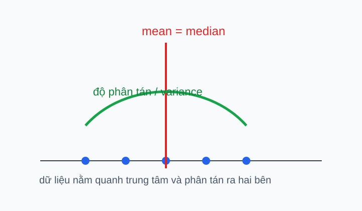
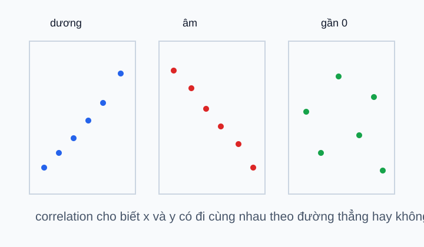

# Statistics for AI Engineer

Statistics giúp bạn hiểu dữ liệu trước khi train model. Một AI Engineer không chỉ đưa dữ
liệu vào model, mà còn phải biết dữ liệu có sạch không, có lệch không, feature nào quan trọng,
và kết quả đánh giá có đáng tin không.



## 1. Mục Tiêu Học

Sau chương này, bạn cần hiểu được:

- Mean, median, mode dùng để mô tả trung tâm dữ liệu.
- Variance và standard deviation dùng để đo độ phân tán.
- Outlier ảnh hưởng đến thống kê như thế nào.
- Correlation giúp đọc quan hệ giữa feature và target.
- Sampling giúp ước lượng dữ liệu lớn ra sao.
- Train/validation/test split liên quan gì đến thống kê.

## 2. Bức Tranh Lớn

Machine learning học từ dữ liệu. Nếu dữ liệu sai, lệch hoặc không đại diện, model sẽ học sai.
Statistics là bộ công cụ để trả lời các câu hỏi:

```text
Dữ liệu nằm quanh đâu?
Dữ liệu phân tán mạnh hay yếu?
Có giá trị bất thường không?
Feature này có liên quan đến target không?
Mẫu dữ liệu hiện tại có đại diện cho toàn bộ population không?
```

Ví dụ: trước khi dự đoán giá nhà, ta nên biết diện tích trung bình là bao nhiêu, giá nhà
phân tán ra sao, nhà quá đắt có phải outlier không, diện tích có tương quan với giá không.

## 3. Mean

Mean là giá trị trung bình.

```text
mean = (x1 + x2 + ... + xn) / n
```

Ví dụ tính tay:

```text
scores = [7, 8, 9, 6, 10]
mean = (7 + 8 + 9 + 6 + 10) / 5 = 8
```

Python:

```python
import numpy as np

scores = [7, 8, 9, 6, 10]
print(np.mean(scores))  # 8.0
```

Trong AI:

- Dùng để tóm tắt feature.
- Dùng trong standardization: `x_scaled = (x - mean) / std`.
- Dùng trong loss như MSE: lấy trung bình bình phương lỗi.

## 4. Median

Median là giá trị ở giữa sau khi sắp xếp.

```text
scores = [7, 8, 9, 6, 10]
sắp xếp = [6, 7, 8, 9, 10]
median = 8
```

Nếu số lượng phần tử chẵn:

```text
scores = [6, 7, 8, 10]
median = (7 + 8) / 2 = 7.5
```

Python:

```python
import numpy as np

scores = [6, 7, 8, 10]
print(np.median(scores))  # 7.5
```

Median hữu ích khi có outlier:

```text
[7, 8, 9, 10, 1000]
mean = 206.8
median = 9
```

Mean bị kéo mạnh bởi `1000`, median ổn định hơn.

## 5. Mode

Mode là giá trị xuất hiện nhiều nhất.

```text
labels = ["spam", "not_spam", "spam", "spam"]
mode = "spam"
```

Mode hay dùng với dữ liệu categorical:

- Nhãn phân loại phổ biến nhất.
- Loại sản phẩm xuất hiện nhiều nhất.
- Quốc gia/user segment phổ biến nhất.

Python:

```python
from collections import Counter

labels = ["spam", "not_spam", "spam", "spam"]
mode = Counter(labels).most_common(1)[0]
print(mode)  # ('spam', 3)
```

## 6. Variance Và Standard Deviation

Variance đo mức độ dữ liệu phân tán quanh mean.

```text
variance = trung bình của (x - mean)^2
std = sqrt(variance)
```

Ví dụ tính tay:

```text
scores = [7, 8, 9, 6, 10]
mean = 8

(7 - 8)^2  = 1
(8 - 8)^2  = 0
(9 - 8)^2  = 1
(6 - 8)^2  = 4
(10 - 8)^2 = 4

variance = (1 + 0 + 1 + 4 + 4) / 5 = 2
std = sqrt(2) = 1.414
```

Python:

```python
import numpy as np

scores = [7, 8, 9, 6, 10]
print(np.var(scores))  # 2.0
print(np.std(scores))  # 1.414...
```

Trong AI:

- Feature có variance gần 0 thường ít thông tin.
- Standard deviation giúp phát hiện điểm bất thường.
- PCA tìm các hướng có variance cao.

## 7. Population Và Sample

Population là toàn bộ tập ta quan tâm. Sample là một phần được lấy ra từ population.

Ví dụ:

```text
Population: tất cả người dùng của app.
Sample: 10.000 người dùng được lấy ra để phân tích.
```

Vấn đề: sample có thể lệch.

Ví dụ:

```text
Nếu chỉ lấy user hoạt động ban ngày, model có thể học sai hành vi user hoạt động ban đêm.
```

Trong AI:

- Dataset train là sample của thế giới thật.
- Nếu sample không đại diện, model khó generalize.

## 8. Sampling

Sampling là lấy mẫu từ tập lớn.

Python:

```python
import numpy as np

population = np.random.normal(100, 15, 100000)
true_mean = np.mean(population)

for size in [10, 50, 100, 1000]:
    sample = np.random.choice(population, size=size)
    print(size, np.mean(sample), abs(np.mean(sample) - true_mean))
```

Trực giác:

- Sample nhỏ: nhanh nhưng dao động nhiều.
- Sample lớn: ổn định hơn nhưng tốn tài nguyên hơn.

## 9. Correlation

Correlation đo quan hệ tuyến tính giữa hai biến.



Giá trị nằm trong khoảng `[-1, 1]`:

```text
 1  -> x tăng thì y tăng mạnh
 0  -> không thấy quan hệ tuyến tính rõ
-1  -> x tăng thì y giảm mạnh
```

Ví dụ:

```python
import numpy as np

hours = [1, 2, 3, 4, 5]
scores = [50, 55, 65, 70, 80]

r = np.corrcoef(hours, scores)[0, 1]
print(round(r, 3))  # gần 0.989
```

Trong AI:

- Kiểm tra feature có liên quan đến target không.
- Phát hiện feature trùng thông tin.
- Hiểu dữ liệu trước khi chọn model.

Lưu ý rất quan trọng:

```text
Correlation không đồng nghĩa với causation.
```

Hai biến cùng tăng không có nghĩa biến này gây ra biến kia.

## 10. Standardization

Standardization đưa dữ liệu về mean 0 và standard deviation 1.

```text
z = (x - mean) / std
```

Ví dụ:

```python
import numpy as np

ages = np.array([20, 30, 40, 50])
z = (ages - np.mean(ages)) / np.std(ages)
print(z)
```

Vì sao cần trong AI:

- Feature có scale quá khác nhau có thể làm training khó hơn.
- Gradient descent thường ổn định hơn khi feature được scale tốt.
- Một số model như logistic regression, SVM, neural network thường hưởng lợi từ scaling.

## 11. Train, Validation, Test

Một lỗi phổ biến là đánh giá model trên chính dữ liệu đã train.

Chia dữ liệu thường gặp:

```text
Train      -> model học
Validation -> chọn model/hyperparameter
Test       -> đánh giá cuối cùng
```

Ví dụ:

```text
70% train
15% validation
15% test
```

Trong AI, chia dữ liệu đúng là vấn đề thống kê: ta muốn ước lượng khả năng model hoạt động
trên dữ liệu chưa từng thấy.

## 12. Python Lab: Phân Tích Dữ Liệu Nhà Đất

```python
import numpy as np
import pandas as pd

np.random.seed(42)
n = 200

df = pd.DataFrame({
    "area": np.random.normal(100, 30, n),
    "bedrooms": np.random.randint(1, 5, n),
    "age": np.random.randint(0, 30, n),
})

df["price"] = 500 + df["area"] * 3 - df["age"] * 2 + np.random.normal(0, 80, n)

print(df.describe())
print(df.corr(numeric_only=True)["price"].sort_values(ascending=False))
```

Cách đọc:

- `describe()` cho biết mean, std, min, max, quartile.
- Correlation với `price` cho biết feature nào có quan hệ tuyến tính với giá.
- Nếu `area` tương quan cao với `price`, đó là feature đáng chú ý.
- Nếu `age` tương quan âm, nhà cũ có xu hướng rẻ hơn.

## 13. Ứng Dụng Trong AI

Statistics dùng trong:

- Data exploration trước khi train.
- Phát hiện outlier.
- Feature scaling.
- Chọn feature.
- Đọc metric như accuracy, precision, recall.
- Đánh giá A/B testing.
- Theo dõi data drift sau khi deploy model.

## 14. Lỗi Hay Nhầm

- Chỉ nhìn mean mà bỏ qua median và outlier.
- Nghĩ correlation cao nghĩa là quan hệ nhân quả.
- Dùng toàn bộ dữ liệu để train rồi lại đánh giá trên chính dữ liệu đó.
- Scale dữ liệu trước khi chia train/test, gây data leakage.
- Tin vào sample nhỏ mà không kiểm tra độ đại diện.

## 15. Bài Tập

### Cơ bản

1. Tính mean, median của `[2, 4, 6, 8, 100]`.
2. Tính variance của `[1, 2, 3]`.
3. Giải thích vì sao median tốt hơn mean khi có outlier.

### Trung bình

1. Tạo 1.000 số từ normal distribution rồi tính mean/std.
2. Tạo hai biến có correlation dương và tính correlation bằng NumPy.
3. Viết hàm standardize một list số.

### AI-oriented

1. Giải thích vì sao train/test split giúp kiểm tra khả năng generalize.
2. Giải thích data leakage là gì bằng ví dụ scaling.
3. Với bài toán dự đoán giá nhà, hãy liệt kê 5 feature bạn muốn thống kê trước khi train.

## 16. Checklist Cần Nhớ

- Mean cho biết trung tâm nhưng nhạy với outlier.
- Median ổn định hơn khi dữ liệu lệch.
- Variance/std đo độ phân tán.
- Correlation đo quan hệ tuyến tính, không chứng minh nhân quả.
- Sampling giúp ước lượng population từ một phần dữ liệu.
- Train/validation/test split giúp đánh giá model công bằng hơn.

