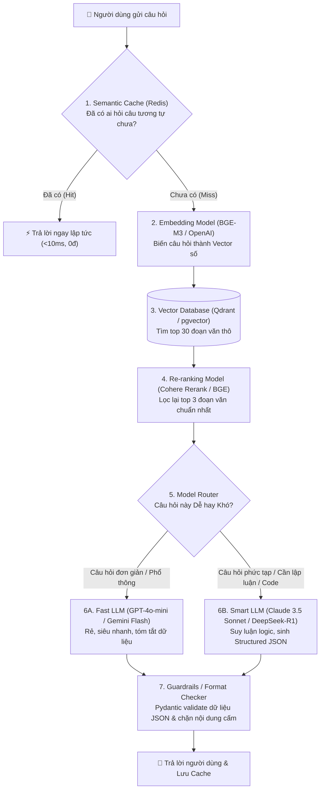

# 🗺️ BẢN ĐỒ CÁC MÔ HÌNH AI THỰC CHIẾN (AI MODELS LANDSCAPE & PLAYBOOK)

> **Mục tiêu tài liệu:** Giúp bạn kết nối các thuật ngữ lý thuyết (Embedding, RAG, Agent, Quantization, LoRA, MoE, vLLM,...) vào các mô hình AI cụ thể đang được sử dụng trong các hệ thống phần mềm thực tế hiện nay.

---

## 📑 MỤC LỤC
1. [Sơ đồ liên kết: Các mô hình phối hợp trong một hệ thống thực tế](#1-sơ-đồ-liên-kết-các-mô-hình-phối-hợp-trong-một-hệ-thống-thực-tế)
2. [Frontier Models (Mô hình đóng đầu bảng qua Cloud API)](#2-frontier-models-mô-hình-đóng-đầu-bảng-qua-cloud-api)
3. [Open-Weight Models (Mô hình mở tự host & Fine-tune)](#3-open-weight-models-mô-hình-mở-tự-host--fine-tune)
4. [Reasoning Models (Mô hình tư duy sâu)](#4-reasoning-models-mô-hình-tư-duy-sâu)
5. [Specialized Models (Mô hình chuyên dụng cho RAG & Media)](#5-specialized-models-mô-hình-chuyên-dụng-cho-rag--media)
6. [Bảng so sánh tổng hợp & Chi phí](#6-bảng-so-sánh-tổng-hợp--chi-phí)
7. [Playbook: Chiến lược chọn mô hình cho AI Engineer](#7-playbook-chiến-lược-chọn-mô-hình-cho-ai-engineer)

---

## 1. SƠ ĐỒ LIÊN KẾT: CÁC MÔ HÌNH PHỐI HỢP TRONG MỘT HỆ THỐNG THỰC TẾ

Một sai lầm phổ biến của người mới là nghĩ rằng *"ứng dụng AI chỉ cần gọi 1 con ChatGPT là xong"*. Trong thực tế sản xuất của doanh nghiệp, một hệ thống AI là một **dàn nhạc giao hưởng** gồm nhiều mô hình chuyên biệt phối hợp với nhau:



---

## 2. FRONTIER MODELS (MÔ HÌNH ĐÓNG ĐẦU BẢNG QUA CLOUD API)

Đây là những mô hình "quái vật" do các tập đoàn công nghệ lớn huấn luyện trên hàng nghìn cụm GPU máy chủ. Bạn chỉ có thể tiếp cận qua trả tiền theo lượt dùng (API Pay-as-you-go).

### 1. Anthropic Claude (Claude 3.5 Sonnet, Claude 3.5 Haiku)
- **Vị thế:** "Vua" của thế giới lập trình, viết code, xây dựng **AI Agents** và thực hiện **Tool Calling**.
- **Điểm mạnh:**
  - Viết code sạch, ít lỗi logic nhất thị trường.
  - Tuân thủ cực kỳ chuẩn xác các ràng buộc của Prompt và sinh ra **Structured Output (JSON)** chuẩn xác.
  - Đi đầu trong giao thức **MCP (Model Context Protocol)** kết nối AI với công cụ.
- **Khi nào chọn:** Làm Agent tự hành phức tạp, sinh code tự động, xử lý văn bản đòi hỏi văn phong thông minh, sắc sảo.

### 2. OpenAI GPT-4o & GPT-4o-mini
- **Vị thế:** Chuẩn mực phổ biến toàn cầu, hệ sinh thái công cụ hỗ trợ nhiều nhất.
- **Điểm mạnh:**
  - Tốc độ phản hồi cực nhanh, khả năng đa phương thức (Multimodal: đọc ảnh, nghe nói) mượt mà.
  - Bản **GPT-4o-mini** có giá siêu rẻ, thay thế hoàn toàn cho GPT-3.5 cũ, dùng làm bot hỗ trợ tác vụ phụ rất kinh tế.
- **Khi nào chọn:** Hệ thống cần độ ổn định tuyệt đối từ hệ thống OpenAI API, làm chatbot đa năng, trích xuất dữ liệu tổng hợp.

### 3. Google Gemini (Gemini 1.5 Pro, Gemini 1.5 Flash, 2.0 Flash)
- **Vị thế:** "Kỷ lục gia" về độ dài bộ nhớ (**Context Window khổng lồ: 1.000.000 – 2.000.000 tokens**).
- **Điểm mạnh:**
  - Có thể nuốt trọn cả một repo code hàng chục file, đọc cả cuốn sách dày cộp hoặc video dài 1 tiếng mà không cần cắt file (chunking).
  - Bản **Gemini 1.5 Flash** cực rẻ, tốc độ siêu tốc.
  - Tích hợp **Prompt Caching** giảm giá thêm 75% cho các văn bản dài lưu sẵn.
- **Khi nào chọn:** Cần tóm tắt tài liệu PDF siêu dài, phân tích video/audio, hoặc các tác vụ cần dung lượng ngữ cảnh vô tận.

---

## 3. OPEN-WEIGHT MODELS (MÔ HÌNH MỞ TỰ HOST & FINE-TUNE)

Đây là những mô hình cho phép tải file trọng số (weights) về máy chủ riêng. Bạn toàn quyền kiểm soát dữ liệu, không lo rò rỉ bí mật kinh doanh, và có thể **Fine-tune (LoRA)** để dạy theo nghiệp vụ riêng.

### 1. Meta Llama 3 Family (Llama 3.1 / 3.2 / 3.3 - 8B, 70B)
- **Vị thế:** "Linux của thế giới GenAI". Được Meta tài trợ, là chuẩn mực nền tảng mà cả cộng đồng thế giới dựa vào để phát triển.
- **Các phiên bản:**
  - `Llama-3.1-8B`: Nhẹ, chạy mượt trên 1 GPU cá nhân (hoặc laptop mạnh qua **Ollama / llama.cpp**), là ứng cử viên số 1 để thực hành **Fine-tuning LoRA**.
  - `Llama-3.3-70B`: Thông minh ngang ngửa các model đóng như GPT-4 đời đầu nhưng có thể tự host.
- **Khi nào chọn:** Khi doanh nghiệp yêu cầu dữ liệu nhạy cảm không được gửi qua OpenAI/Google, cần tự deploy trên máy chủ riêng (on-premise).

### 2. Alibaba Qwen 2.5 Family (Qwen 2.5 - 7B, 14B, 32B, 72B & Qwen-Coder)
- **Vị thế:** Dòng mô hình mở thông minh hàng đầu châu Á hiện nay, đặc biệt **xuất sắc vượt trội về tiếng Việt** và khả năng giải toán/code.
- **Điểm mạnh:**
  - Tokenizer của Qwen tối ưu cực tốt cho các ngôn ngữ tượng hình và ngôn ngữ có dấu (như tiếng Việt), giúp tiết kiệm số lượng token đáng kể so với Llama.
  - Phiên bản **Qwen-2.5-Coder** viết code tiệm cận Claude 3.5 Sonnet.
- **Khi nào chọn:** Xây dựng ứng dụng xử lý tiếng Việt nội bộ, làm trợ lý code offline cho công ty, hoặc fine-tune tác vụ tài chính/kỹ thuật.

### 3. Mistral AI (Mistral 7B, Mixtral 8x7B, 8x22B)
- **Vị thế:** Tiên phong trong kiến trúc **MoE (Mixture of Experts)**.
- **Đặc trưng MoE:** Mô hình có tổng 47 tỷ tham số, nhưng với mỗi từ nó chỉ kích hoạt 13 tỷ tham số cần thiết, giúp tốc độ sinh chữ nhanh hơn hẳn model truyền thống cùng kích thước.

---

## 4. REASONING MODELS (MÔ HÌNH TƯ DUY SÂU)

Trước đây, khi bạn bấm gửi prompt, model sẽ lập tức sinh từ tiếp theo ngay. Nhưng **Reasoning Models** thì khác: nó sẽ có một giai đoạn **"Suy nghĩ ngầm" (Chain-of-Thought)** trước khi trả lời.

```
Prompt ➔ [AI tự độc thoại suy nghĩ: Xem xét trường hợp A... Phản biện: nếu thế thì sai... Thử lại cách B...] ➔ Kết quả cuối
```

### 1. DeepSeek-R1 (và các bản Distilled 8B, 14B, 32B)
- **Hiện tượng toàn cầu 2025:** Chứng minh cho thế giới thấy có thể huấn luyện mô hình tư duy ngang tầm OpenAI o1 với chi phí rẻ hơn hàng chục lần nhờ thuật toán **GRPO** (Group Relative Policy Optimization).
- **Điểm mạnh:** Khả năng giải toán phức tạp, suy luận logic lập trình, phân tích thuật toán siêu đẳng. Có sẵn mã nguồn mở để tải về tự chạy.
- **Khi nào chọn:** Giải các bài toán logic kinh doanh phức tạp, phân tích hợp đồng pháp lý nhiều lớp điều khoản, kiểm tra bảo mật code.

### 2. OpenAI o1 & o3-mini
- **Vị thế:** Mô hình suy luận đóng hàng đầu của OpenAI.
- **Đặc điểm:** Tự động điều chỉnh thời gian "nghĩ" (Reasoning Effort: Low, Medium, High). Nghĩ càng lâu, điểm toán học và lập trình càng cao.

---

## 5. SPECIALIZED MODELS (MÔ HÌNH CHUYÊN DỤNG CHO RAG & MEDIA)

AI Engineer không chỉ dùng mỗi LLM sinh chữ, mà bắt buộc phải biết dùng các mô hình phụ trợ chuyên biệt:

### 1. Embedding Models (Mô hình tạo Vector)
| Model | Đơn vị tạo | Đặc điểm nổi bật |
| :--- | :--- | :--- |
| **BGE-M3** | BAAI | **Top 1 thế giới về đa ngôn ngữ**. Hỗ trợ tiếng Việt cực tốt. Hỗ trợ cả Dense (Vector) + Sparse (BM25) trong cùng 1 model. Chạy local miễn phí. |
| **text-embedding-3-small / large** | OpenAI | Chuẩn công nghiệp qua API. Rất rẻ ($0.02 / 1 triệu token), độ dài 1536 chiều, dễ tích hợp. |
| **Nomic-Embed-Text** | Nomic AI | Mô hình mở, context dài (8192 tokens), chạy rất nhẹ trong Ollama. |

### 2. Re-ranking Models (Mô hình xếp hạng lại tài liệu)
| Model | Cách dùng | Vai trò thực chiến |
| :--- | :--- | :--- |
| **Cohere Rerank v3** | Cloud API | Dùng sau bước tìm kiếm Vector để sắp xếp lại top 3-5 tài liệu chính xác nhất. |
| **BGE-Reranker-Large** | Tự host (GPU) | Bản open-source mạnh mẽ thay thế Cohere, chạy trực tiếp trên server doanh nghiệp. |

### 3. Voice & Vision Models
- **Whisper (OpenAI):** Mô hình chuyển giọng nói thành văn bản (STT) tốt nhất thế giới hiện nay, nhận diện tiếng Việt cực kỳ chuẩn kể cả có tạp âm.
- **ColPali / LlamaParse:** Các mô hình chuyên đọc tài liệu PDF chứa bảng biểu, sơ đồ hình ảnh để đưa vào RAG (Document AI).

---

## 6. BẢNG SO SÁNH TỔNG HỢP & CHI PHÍ

| Nhóm mô hình | Đại diện tiêu biểu | Phương thức | Chi phí tương đối | Tốc độ | Điểm mạnh nhất |
| :--- | :--- | :--- | :--- | :--- | :--- |
| **Tier 1: Siêu trí tuệ** | Claude 3.5 Sonnet, GPT-4o | Cloud API | Trung bình ($3 - $15 / 1M token) | Nhanh | Code, Agent, Tool Calling, Phân tích phức tạp |
| **Tier 2: Siêu rẻ & Nhanh** | GPT-4o-mini, Gemini 1.5 Flash | Cloud API | Siêu rẻ ($0.075 - $0.15 / 1M token) | Cực nhanh | Tóm tắt, trích xuất JSON, Bot xử lý sơ bộ |
| **Tier 3: Tư duy sâu** | DeepSeek-R1, OpenAI o1 | API / Tự host | Cao (do tốn token suy nghĩ) | Chậm (cần thời gian nghĩ) | Toán học, Logic đa bước, Audit bảo mật |
| **Tier 4: Mở & Tự chủ** | Llama 3.1 8B, Qwen 2.5 7B | Chạy Local (Ollama/vLLM) | Miễn phí bản quyền (Tốn tiền điện/GPU) | Phụ thuộc GPU của bạn | Bảo mật dữ liệu 100%, Fine-tune theo domain riêng |
| **Tier 5: Chuyên dụng RAG** | BGE-M3, Cohere Rerank | API / Local | Rất rẻ | Tức thì (<50ms) | Biến văn bản thành vector, chấm điểm tài liệu |

---

## 7. PLAYBOOK: CHIẾN LƯỢC CHỌN MÔ HÌNH CHO AI ENGINEER

Khi nhận một bài toán thực tế từ khách hàng hoặc công ty, bạn hãy trả lời theo sơ đồ quyết định 4 câu hỏi sau:

```
[1. Dữ liệu có bảo mật tuyệt đối không được ra Internet?]
    ├── Có  ➔ BẮT BUỘC dùng Open-source: Qwen 2.5 (tiếng Việt) hoặc Llama 3.1 chạy bằng vLLM trên máy chủ riêng.
    └── Không ➔ Chuyển sang câu hỏi 2.

[2. Bài toán có cần suy luận nhiều bước, giải toán hay phân tích logic sâu?]
    ├── Có  ➔ Chọn Reasoning Model: DeepSeek-R1 hoặc Claude 3.5 Sonnet.
    └── Không ➔ Chuyển sang câu hỏi 3.

[3. Nhiệm vụ chính là gì?]
    ├── Viết Code, điều khiển Agent, gọi Tool ➔ Chọn Claude 3.5 Sonnet.
    ├── Đọc file PDF dài hàng trăm trang, video, audio ➔ Chọn Gemini 1.5 Pro / Flash (tận dụng Context 1M).
    ├── Chatbot phổ thông, phân loại văn bản, trích xuất JSON ➔ Chọn GPT-4o-mini hoặc Gemini 1.5 Flash (tiết kiệm 95% chi phí).

[4. Tìm kiếm thông tin RAG?]
    └── Luôn dùng bộ đôi: BGE-M3 (Embedding) + Cohere Rerank / BGE-Reranker trước khi đưa vào LLM.
```

---

> 💡 **Mẹo vàng cho người học:** Trong các project ở lộ trình, bạn hãy luôn bắt đầu với **GPT-4o-mini** hoặc **Gemini 1.5 Flash** (vì giá cực rẻ hoặc miễn phí hạn mức thử nghiệm), sau đó thử nghiệm chạy local với **Ollama (Qwen 2.5 / Llama 3.1)** để hiểu rõ sự khác biệt giữa Cloud API và Self-hosted AI!
