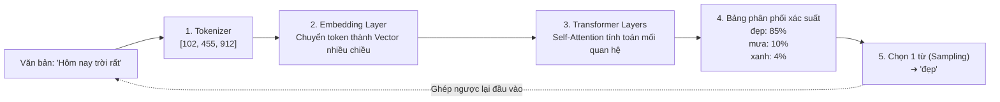
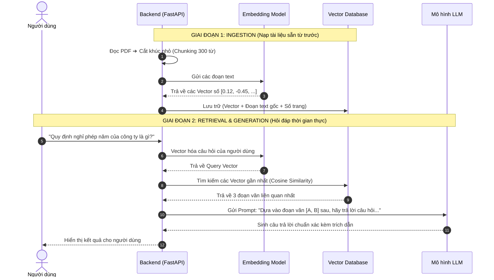
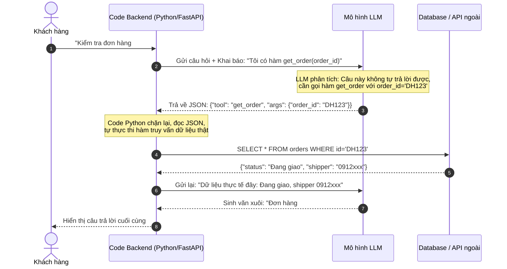
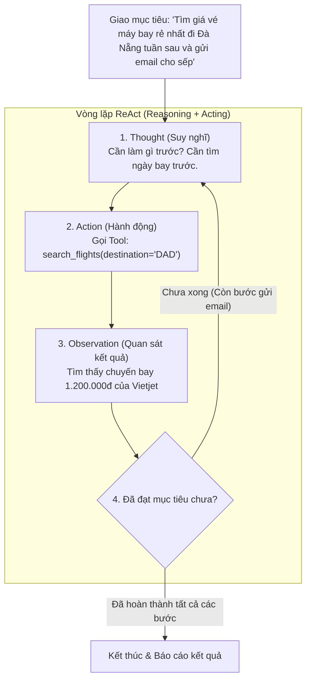

# ⚙️ CÁC MÔ HÌNH HOẠT ĐỘNG CỦA HỆ THỐNG AI (HOW AI WORKS UNDER THE HOOD)

> **Mục tiêu tài liệu:** Bóc tách bản chất kỹ thuật bên dưới nắp ca-pô (Under the hood): AI thực sự hoạt động như thế nào? Dữ liệu đi qua những đâu? Làm sao AI biết đọc tài liệu, biết gọi công cụ, và tự hành động như một Agent?

---

## 📑 MỤC LỤC
1. [Mô hình 1: Cơ chế cốt lõi của LLM (Từ chữ ➔ Vector ➔ Sinh từ tiếp theo)](#1-mô-hình-1-cơ-chế-cốt-lõi-của-llm-từ-chữ--vector--sinh-từ-tiếp-theo)
2. [Mô hình 2: Vòng đời hình thành một mô hình AI (Pre-train ➔ SFT ➔ Alignment ➔ Reasoning)](#2-mô-hình-2-vòng-đời-hình-thành-một-mô-hình-ai-pre-train--sft--alignment--reasoning)
3. [Mô hình 3: Cơ chế hoạt động của RAG (Tra cứu tài liệu động)](#3-mô-hình-3-cơ-chế-hoạt-động-của-rag-tra-cứu-tài-liệu-động)
4. [Mô hình 4: Cơ chế Function Calling / Tool Use (Làm sao AI gọi được API bên ngoài?)](#4-mô-hình-4-cơ-chế-function-calling--tool-use-làm-sao-ai-gọi-được-api-bên-ngoài)
5. [Mô hình 5: Cơ chế hoạt động của AI Agent & Vòng lặp ReAct](#5-mô-hình-5-cơ-chế-hoạt-động-của-ai-agent--vòng-lặp-react)
6. [Mô hình 6: Cơ chế hoạt động của Fine-tuning & LoRA](#6-mô-hình-6-cơ-chế-hoạt-động-của-fine-tuning--lora)

---

## 1. MÔ HÌNH 1: CƠ CHẾ CỐT LÕI CỦA LLM (TỪ CHỮ ➔ VECTOR ➔ SINH TỪ TIẾP THEO)

Bản chất tối thượng của mọi LLM (ChatGPT, Claude, Llama): **Nó là một cỗ máy dự đoán từ tiếp theo (Next-Token Prediction Engine)** dựa trên xác suất thống kê.



### Chi tiết 5 bước diễn ra bên trong:
1. **Bước 1 - Tokenization (Băm chữ):** Máy tính không hiểu chữ cái. Câu `"Hôm nay trời rất"` được bộ Tokenizer băm thành các ID số nguyên: `[102, 455, 912]`.
2. **Bước 2 - Embedding (Ánh xạ không gian):** Mỗi số ID được tra cứu trong một bảng từ điển khổng lồ để lấy ra một **Vector** (dãy 4096 số thực). Dãy số này đại diện cho "tọa độ ngữ nghĩa" của từ đó.
3. **Bước 3 - Transformer & Self-Attention (Hiểu ngữ cảnh):** 
   - Các vector đi qua hàng chục tầng nơ-ron (Layers).
   - Cơ chế **Self-Attention** sẽ làm phép nhân ma trận giữa tất cả các từ với nhau. Nó tự hỏi: *"Từ 'rất' đang bổ nghĩa cho từ nào phía trước?"*, *"Chủ ngữ câu này là gì?"*. Nhờ vậy, tọa độ của các vector được cập nhật để mang trọn vẹn ngữ cảnh của cả câu.
4. **Bước 4 - Tính xác suất từ tiếp theo (Logits & Softmax):** Ở tầng cuối cùng, mô hình xuất ra một bảng xác suất cho tất cả 100.000 từ có trong từ điển của nó:
   - Chữ `"đẹp"`: 85%
   - Chữ `"mưa"`: 10%
   - Chữ `"xanh"`: 4%
   - Chữ `"cơm"`: 0.0001%
5. **Bước 5 - Chọn từ & Tự hồi quy (Autoregressive Loop):** 
   - Dựa vào tham số `temperature`, mô hình bốc ngẫu nhiên một từ (ví dụ bốc được chữ `"đẹp"`).
   - Nó lập tức nhét chữ `"đẹp"` này ngược trở lại câu đầu vào thành: `"Hôm nay trời rất đẹp"` và lặp lại toàn bộ chu trình để đoán từ tiếp theo (`"và"`). Cứ thế, từng chữ được bắn ra màn hình (Streaming).

---

## 2. MÔ HÌNH 2: VÒNG ĐỜI HÌNH THÀNH MỘT AI (TỪ DỮ LIỆU THÔ ĐẾN THÔNG MINH)

Làm sao từ một đống số vô tri mà AI biết nói chuyện như con người? Quá trình huấn luyện diễn ra qua 4 tầng:

```
[Internet: Hàng nghìn tỷ từ] 
         ↓
  1. Pre-training (Tiền huấn luyện) ➔ Tạo ra Base Model (Chỉ biết điền từ tiếp theo)
         ↓
  2. SFT: Supervised Fine-Tuning ➔ Tạo ra Instruct Model (Biết trả lời câu hỏi)
         ↓
  3. Alignment: RLHF / DPO ➔ Tạo ra Safe Model (Ngoan ngoãn, không nói bậy)
         ↓
  4. Reasoning: GRPO / RL ➔ Tạo ra Thinking Model (Biết suy nghĩ nháp như DeepSeek-R1)
```

1. **Pre-training (Nuốt trọn Internet):**
   - Đưa cho mô hình đọc hàng nghìn tỷ từ trên Wikipedia, báo chí, code GitHub, sách vở.
   - Nhiệm vụ duy nhất lúc này: *"Đọc nửa câu trước, đoán nửa câu sau"*.
   - **Kết quả:** Tạo ra **Base Model**. Model này cực kỳ uyên bác nhưng **chưa dùng được**. Nếu bạn hỏi nó: *"Thủ đô nước Pháp là gì?"*, nó có thể không trả lời mà lại tự viết tiếp: *"Thủ đô nước Ý là gì? Thủ đô nước Đức là gì?"* (vì nó tưởng bạn đang viết một đề thi trắc nghiệm).
2. **SFT (Supervised Fine-Tuning - Dạy nghe lời):**
   - Dạy mô hình bằng 100.000 cặp câu hỏi - câu trả lời chuẩn do con người viết:
     - `User: Thủ đô nước Pháp là gì?` ➔ `Assistant: Thủ đô nước Pháp là Paris.`
   - **Kết quả:** Biến Base Model thành **Instruct Model** (biết đóng vai trợ lý AI).
3. **Alignment (Căn chỉnh đạo đức bằng RLHF / DPO):**
   - Huấn luyện mô hình từ chối các yêu cầu độc hại (chế tạo vũ khí, chửi bậy, phân biệt đối xử) và ưu tiên câu trả lời hữu ích, trung thực.
4. **Reasoning Post-Training (Huấn luyện tư duy sâu - Chuẩn mới 2025):**
   - Sử dụng học tăng cường (RL / GRPO như DeepSeek-R1, OpenAI o1): Cho AI giải hàng vạn bài toán/code. 
   - Nếu làm đúng thì được thưởng điểm, làm sai bị trừ điểm. AI tự học được thói quen: **Tự nháp, tự phản biện, tự sửa lỗi sai trong đầu trước khi đưa ra kết quả cuối cùng**.

---

## 3. MÔ HÌNH 3: CƠ CHẾ HOẠT ĐỘNG CỦA RAG (TRA CỨU TÀI LIỆU ĐỘNG)

Doanh nghiệp không thể ném tài liệu nội bộ vào để train lại LLM (vừa đắt hàng tỷ đồng, vừa bị lộ dữ liệu). **RAG** giải quyết bằng 2 luồng hoạt động độc lập:



### Tại sao Vector Search lại tìm được đoạn văn liên quan?
- **Phép toán Cosine Similarity (Độ tương đồng Cosine):** 
  - Mỗi đoạn văn được coi như một mũi tên trong không gian nhiều chiều.
  - Khi bạn hỏi, câu hỏi tạo thành mũi tên $\vec{A}$. Đoạn tài liệu tạo thành mũi tên $\vec{B}$.
  - Máy tính tính góc $\theta$ giữa hai mũi tên: $\cos(\theta) = \frac{\vec{A} \cdot \vec{B}}{\|\vec{A}\| \|\vec{B}\|}$.
  - Góc càng nhỏ ($\cos \approx 1$), nghĩa là hai đoạn văn càng có **ngữ nghĩa giống nhau**, bất kể chúng dùng từ ngữ khác nhau (ví dụ: *"nghỉ việc"* và *"thôi việc"* mũi tên sẽ chỉ gần như trùng nhau).

---

## 4. MÔ HÌNH 4: CƠ CHẾ FUNCTION CALLING (LÀM SAO AI GỌI ĐƯỢC API BÊN NGOÀI?)

Rất nhiều người nhầm rằng: *"AI tự kết nối Internet và tự bấm nút gọi API"*. **Thực tế AI không có quyền hạn đó!** Toàn bộ là sự phối hợp ăn ý giữa LLM và Backend Code:



👉 **Bản chất kỹ thuật:** LLM thực chất chỉ đóng vai trò là **bộ não ra quyết định** (Decision Maker). Nó đọc câu hỏi và sinh ra một chuỗi JSON chứa tên hàm và tham số. **Code phần mềm của bạn mới là tay chân thực thi.**

---

## 5. MÔ HÌNH 5: CƠ CHẾ HOẠT ĐỘNG CỦA AI AGENT & VÒNG LẶP ReAct

Khác với Chatbot hỏi một câu đáp một câu, **AI Agent** là một **vòng lặp suy luận có trạng thái (Stateful Reasoning Loop)**. Nó tự chạy cho đến khi đạt được mục tiêu thì thôi.



### 3 Thành phần sống còn của một AI Agent:
1. **Planning (Lập kế hoạch):** Agent biết bẻ nhỏ mục tiêu lớn thành các việc con tuần tự (Step 1 ➔ Step 2 ➔ Step 3).
2. **Memory (Bộ nhớ):**
   - *Short-term memory:* Lịch sử các bước vừa làm trong phiên chạy (để không làm lại việc đã làm).
   - *Long-term memory:* Lưu thông tin về sở thích của người dùng vào Vector DB/SQL để tháng sau vẫn nhớ.
3. **Stop Condition (Điều kiện dừng):** AI Engineer phải quy định số bước tối đa (Max Iterations, ví dụ 10 bước). Nếu Agent bị kẹt trong vòng lặp vô hạn, hệ thống sẽ ngắt và báo lỗi thay vì đốt hết tiền API.

---

## 6. MÔ HÌNH 6: CƠ CHẾ HOẠT ĐỘNG CỦA FINE-TUNING & LoRA

Một mô hình 8 tỷ tham số (như Llama 3 8B) có nghĩa là có 8.000.000.000 con số trọng số ($W$) lưu trong file.

### Huấn luyện truyền thống (Full Fine-tuning) - Đắt đỏ:
- Bạn phải cập nhật lại toàn bộ 8 tỷ con số này.
- Cần hàng chục cụm card GPU A100/H100 cực khủng, tốn hàng trăm triệu đồng, file model lưu ra nặng hàng chục GB.

### Huấn luyện hiện đại bằng LoRA (Low-Rank Adaptation) - Thông minh & Tiết kiệm:
```
           Trọng số gốc W₀ (ĐÓNG BĂNG 100%, KHÔNG CHẠM VÀO)
                                 +
  ┌─────────────────────────────────────────────────────────────┐
  │   Nhánh LoRA nhỏ bổ sung:                                   │
  │   Ma trận A (nhỏ)  ×  Ma trận B (nhỏ)                       │
  │   (Chỉ chiếm 0.1% số tham số - Chỉ train nhánh này)         │
  └─────────────────────────────────────────────────────────────┘
```

- **Nguyên lý toán học:** Thay vì sửa ma trận khổng lồ kích thước $(4096 \times 4096) = 16.7$ triệu tham số, LoRA phân rã thành tích của 2 ma trận nhỏ: $(4096 \times 16)$ và $(16 \times 4096) = 131.000$ tham số (giảm tải 128 lần!).
- **Lợi ích thực tế:**
  - Mô hình gốc được **giữ nguyên (Freeze)**, không sợ bị "hỏng" kiến thức cũ.
  - Bạn có thể train trên một chiếc máy tính cá nhân hoặc thuê GPU giá rẻ ($0.5/giờ trên RunPod).
  - File kết quả (LoRA adapter) chỉ nặng khoảng **50MB - 100MB** (thay vì 16GB), cực kỳ dễ dàng tải lên tải xuống và triển khai.

---

## 🎯 TỔNG KẾT: TẤT CẢ LIÊN KẾT VỚI NHAU NHƯ THẾ NÀO?

| Khi bạn cần... | Bạn sẽ dùng mô hình hoạt động nào? |
| :--- | :--- |
| Trả lời câu hỏi tổng quát, viết lách | **Mô hình 1 & 2** (LLM thuần qua Next-token prediction) |
| Trả lời dựa trên dữ liệu riêng của công ty | **Mô hình 3** (RAG: Embedding ➔ Vector DB ➔ Prompt injection) |
| Lấy dữ liệu trực tiếp từ SQL, thời tiết, tra cứu đơn hàng | **Mô hình 4** (Function Calling: LLM sinh JSON ➔ Backend chạy code) |
| Tự động hóa công việc nhiều bước độc lập | **Mô hình 5** (AI Agent: ReAct Loop tuần tự) |
| Dạy AI phong cách nói chuyện riêng, thuật ngữ nội bộ sâu | **Mô hình 6** (Fine-tuning với LoRA/QLoRA) |
